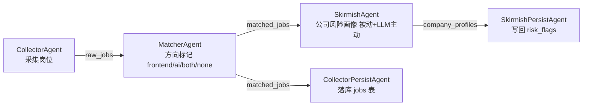

<div align="center">

# 🤖 Multi-Agent AI 投递助手

**AI Job Application Assistant（2026H2P）**

一套面向求职场景的**全栈 + LLM 多 Agent 自动化系统**：管理简历、配置筛选条件、采集岗位、AI 匹配方向、生成公司风险画像、跟踪投递记录 —— 让海投变成"半自动流水线，人工兜底"。


</div>

---

## ✨ 亮点

| 维度 | 内容 |
|---|---|
| **Multi-Agent 架构** | 以"接口契约"为核心的 Agent 框架：共享 State（Pydantic 命名空间分区）→ `BaseAgent.run(state)->state` → 编排器线性串行；**加新 Agent 不推倒核心** |
| **编排器可演进** | 短期 `SequentialOrchestrator`（朴素线性串），接口与 `BaseOrchestrator` 契约一致，后期可无痛换 **LangGraph StateGraph** |
| **LLM Provider 抽象** | `deepseek / minimax / ollama` 一个 `.env` 变量切换；无 Key 时优雅降级为纯规则模式 |
| **全栈 Web 管理台** | Flask REST API + Vue 3 + TypeScript + Pinia + Tailwind，7 个视图覆盖全流程 |
| **工程化配套** | 接口契约测试（防推倒核心）、统一日志轮转、Agent 注册表驱动的前端表单、完整设计文档 |

## 🏗️ 系统架构

```
                    ┌─────────────────────────────┐
                    │      Vue 3 前端 (5173)       │
                    │  Dashboard / JobList / ...   │
                    └──────────────┬──────────────┘
                                   │ REST (5000, CORS)
                    ┌──────────────▼──────────────┐
                    │     Flask 后端 (SQLAlchemy)   │
                    │  routes: jobs / resumes /     │
                    │  config / records / agents    │
                    └──────┬───────────────┬───────┘
                           │               │
                ┌──────────▼───┐   ┌───────▼────────┐
                │   SQLite DB   │   │ Agent 触发 API  │
                │ jobs/resumes/ │   │ (subprocess 跑  │
                │ config/records│   │  core 流水线)   │
                └──────────────┘   └───────┬────────┘
                                           │
                    ┌──────────────────────▼──────────────────────┐
                    │        core/ — Multi-Agent 编排层            │
                    │                                              │
                    │   AgentState (Pydantic, 命名空间分区)          │
                    │    collector.* → matcher.* → skirmish.*      │
                    │         │                                    │
                    │   BaseAgent.run(state) -> state  ◄── 抽象     │
                    │         │                                    │
                    │   SequentialOrchestrator（后期可换 LangGraph） │
                    └──────────────────────────────────────────────┘
```

**Agent 流水线状态流**（Scratchpad 模式，Agent 之间不直接调用，只读写共享 State）：



**Agent 接口契约**（`core/agents/base.py`）：

- 每个 Agent 继承 `BaseAgent`，实现 `run(state) -> state`
- 共享 `AgentState` 按命名空间分区（`collector.* / matcher.* / skirmish.* / analyzer.*`），每个 Agent 只写自己的命名空间
- 新增 Agent = 写一个 class + State 加一段字段，**其余代码零改动**
- 接口有测试守护：`core/tests/test_agents.py`

## 📁 仓库结构

```
.
├── core/                      # Multi-Agent 编排层（2.0）
│   ├── agents/
│   │   ├── base.py            #   接口契约：AgentState / BaseAgent / BaseOrchestrator
│   │   ├── collector.py       #   采集 Agent（调第三方 scraper）+ 落库
│   │   ├── matcher.py         #   方向匹配 Agent（规则 + 关键词统计）
│   │   ├── skirmish.py        #   公司避坑 Agent（被动信息包 + 可选 LLM 风险标签）
│   │   ├── orchestrator.py    #   编排器（SequentialOrchestrator / build_default_pipeline）
│   │   ├── llm_client.py      #   LLM provider 抽象（deepseek/minimax/ollama）
│   │   └── logging_setup.py   #   运行日志（控制台 + 文件轮转 + 摘要）
│   ├── scripts/               # 命令行入口（run_collector / run_matcher / run_skirmish）
│   ├── tests/                 # 接口契约测试（防推倒核心）
│   ├── docs/                  # Agent 架构设计
│   ├── 采集一次.bat            # Windows 一键入口
│   ├── 匹配一次.bat
│   ├── 避坑一次.bat
│   ├── 启动Chrome.bat / 停止Chrome.bat
│   └── ...
├── web/
│   ├── backend/               # Flask 后端
│   │   ├── app/
│   │   │   ├── models/        #   jobs / resumes / config / records / agent_config
│   │   │   ├── routes/        #   REST API（含 Agent 触发与管理 API）
│   │   │   ├── services/      #   简历解析（PyMuPDF / PaddleOCR）
│   │   │   └── utils/
│   │   ├── scripts/           #   BOSS JSON 导入工具
│   │   ├── .env.example       #   环境变量模板（复制为 .env）
│   │   └── requirements.txt
│   ├── frontend/              # Vue 3 + TS + Pinia + Tailwind
│   │   └── src/
│   │       ├── views/         #   Dashboard / JobList / JobDetail / ConfigCenter
│   │       │                  #   ResumeManager / DeliveryHistory / AgentManage
│   │       ├── api/ stores/ types/ components/
│   │       └── ...
│   ├── start.bat              # Windows 一键启动前后端
│   ├── README.md              # Web 端说明
│   └── 开发进度.md             # 完整开发记录（10 轮，含根因分析）
└── docs/                      # 需求拆分 / 需求文档 / 架构设计 / 架构定稿
    │                          # 采集运行模式深度调研 / BOSS 反爬调研 / 类型 B 落地分析
    └── ...
```

## 🚀 快速开始

> 环境要求：Python 3.10+ · Node.js 18+（仅前端需要）

```bash
# ── 1. 后端 ─────────────────────────────
cd web/backend
pip install -r requirements.txt
cp .env.example .env          # 填入 LLM API Key（见 .env 注释）
python -m app.app             # 监听 127.0.0.1:5000，首次运行自动建表

# ── 2. 前端（另开终端）──────────────────
cd web/frontend
npm install
npm run dev                   # 打开 http://localhost:5173
```

Windows 也可以用 `web/start.bat` 一键启动前后端。

### Agent 流水线（可选，命令行）

```bash
cd core
python scripts/run_collector.py --keyword "AI开发" --city 广州 --pages 1   # 采集→匹配→避坑 全链路
python scripts/run_matcher.py --persist      # 只对 DB 已有岗位跑方向匹配
python scripts/run_skirmish.py --persist     # 只跑公司避坑
python -m pytest tests/ -v                   # 接口契约测试
```

> **采集前置**：采集链路依赖第三方开源工具 [eatmoreduck/boss-zhipin-scraper](https://github.com/eatmoreduck/boss-zhipin-scraper)（MIT）。将其克隆到仓库根 `tools/boss-zhipin-scraper/` 即可（不参与采集则无需安装，其余功能全部可用）。

## 🧭 使用流程

1. **简历管理** — 上传 PDF / 图片简历，自动解析结构化信息
2. **条件配置** — 设定搜索关键词、目标城市、筛选条件（薪资/学历/黑名单公司）
3. **岗位采集** — Web 台一键触发 或 CLI 运行（半自动，人工在专用 Chrome 中登录）
4. **AI 匹配** — 对岗位做方向标记（frontend / ai / both / none）+ 基础过滤
5. **避坑画像** — 为匹配岗位生成"公司+岗位"信息包，可选 LLM 生成风险标签（只做参考，人判读）
6. **结果展示** — 卡片式岗位列表，按方向分组、标注状态
7. **投递记录** — 手动标记"已投递 / 已沟通 / 不合适"，跟踪进展

## ⚠️ 合规声明

本系统面向**个人求职场景**，采用"半自动 + 人工兜底"设计：采集前人工登录、投递动作始终由人完成、风险结论仅作参考。请遵守目标平台的服务条款与当地法律法规，勿用于批量抓取、商业转售或对平台造成负担的用途。开发者不对任何滥用行为负责。

## 📄 文档索引

| 文档 | 内容 |
|---|---|
| `docs/需求文档.md` / `docs/需求拆分.md` | 需求全景与逐条拆分 |
| `docs/架构设计.md` / `docs/架构定稿.md` | 1.0/2.0 架构演进与 2.0 定稿方案 |
| `docs/采集运行模式深度调研.md` | "什么时候该跑采集"的深度调研（L1-L4） |
| `docs/BOSS反爬调研报告.md` | 反爬机制技术调研（学习研究） |
| `docs/类型B落地分析与路线对比.md` | 采集链路落地选型对比 |
| `core/docs/Agent架构设计.md` | Agent 接口契约设计 |
| `web/开发进度.md` | 10 轮完整开发记录（含 2026-09-03 全量体检 P0/P1 修复） |

## 📜 License

[MIT](LICENSE) © 2026 Mojun

> 第三方组件：[boss-zhipin-scraper](https://github.com/eatmoreduck/boss-zhipin-scraper) © eatmoreduck，MIT License。
